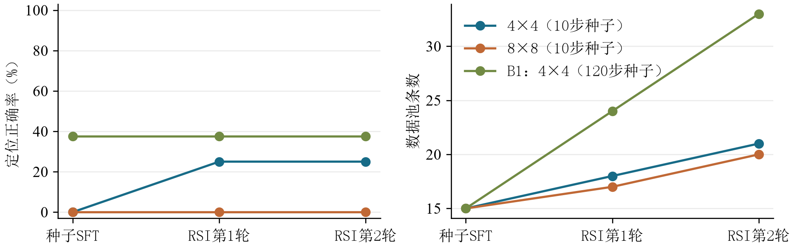

# Assignment 06 — SmolVLM Localization and Recursive Self-Improvement

This experiment uses **HuggingFaceTB/SmolVLM-256M-Instruct** to express an object's center as a grid cell, then applies purple-box visual self-checking, a color-component verifier, verified-answer replay and LoRA retraining. The implementation is **FP32 LoRA**, not 4-bit QLoRA.

## Observed results

These are actual weak/negative results, preserved without changing the test set or hiding failed generations. `correct` is the audit score used below; `guide_correct` keeps a looser reference-matching score separately.

| Track | Seed updates | Final direct localization | Final direct total | Independent total |
| --- | ---: | ---: | ---: | ---: |
| Required 4×4 | 10 | 2/8 | 4/15 | 10/30 |
| B1 4×4 | 120 | 3/8 | 3/15 | 1/30 |
| Matched-budget 8×8 | 10 | 0/8 | 3/15 | 9/30 |

Each track continues for **two RSI rounds of 10 updates each**. B1's 60- and 120-update checkpoints both score 3/8 on localization; its 120-update checkpoint was fixed in advance, not selected using the independent set. B1 Harness reaches 9/15 with tool feedback, but direct generation after retraining remains 3/15. Its replay pool grows 15→24→33 while covering the same 15 image-question pairs. This does **not** establish reliable spatial self-improvement or generalization.

The required 4×4 Harness improves 2/15→3/15. In its second RSI round, two previously correct responses become wrong. No wrong-to-right visual-self-check success was observed. Additional 10-step EOS/prompt diagnostics also yielded 0/8 localization in every arm. An integral-decimal scoring bug (`1.0.` split into 1 and 0) was fixed by rescoring saved predictions; the original localization failure remained unchanged.



## Prepare

Use Python 3.12 with the versions in [requirements.txt](requirements.txt). The recorded run used torch 2.8.0+cu128. The program also accepts `--device cpu`, but the published timings/results were measured with CUDA.

```bash
python -m venv .venv
# Windows: .venv\Scripts\Activate.ps1
# Linux: source .venv/bin/activate
python -m pip install torch==2.8.0 torchvision==0.23.0 --index-url https://download.pytorch.org/whl/cu128
python -m pip install -r requirements.txt
hf download HuggingFaceTB/SmolVLM-256M-Instruct --local-dir models/SmolVLM-256M-Instruct --include "*.json" "*.safetensors" "*.txt" "*.model" "*.jinja" --exclude "onnx/*"
```

Model loading is offline. Download the model first or provide an existing local path using `--model-path`. Weights and adapters are intentionally excluded from this attachment.

## Reproduce

Run commands inside this assignment directory:

```bash
python hw6_rsi_localize.py --mode make_data
python -m unittest test_hw6 -v
# Independent fresh runs; no previous coursework folder or cached adapter is needed.
python run_experiments.py --track all --accept-low-accuracy
```

The matrix runner rebuilds the original 10-step seed, the B1 branch with 60/120 cumulative updates, and the matched-budget 8×8 branch. All seed checkpoints and optimizer states are saved. `b1_grid4/sft/` is an alias of the 120-step checkpoint, not another training run. The exported histories omit that duplicate alias.

By default the quality gate exits 20 on weak trained-model scores. `--accept-low-accuracy` explicitly allows the failure-inclusive matrix to finish; non-finite loss or gradients still stop execution. Existing run directories are never overwritten. Use `--output-root results/repeat` for another matrix, `--track standard4`, `--track b1` or `--track grid8` for one branch, and `--model-path`/`--device` when needed.

The single-file CLI also supports `make_sft` (`make_seed` alias), `infer`, `sft`, `eval`, `rsi`, and `all`. Avoid `--mode all --steps 120` when reproducing B1: that would also set each RSI round to 120 updates. Instead use the matrix runner, which fixes RSI at 10 updates per round.

Optional fixed-budget format diagnostics:

```bash
python diagnose_format.py
```

It uses published uncorrected control predictions in `artifacts/required_grid4/`, creates three fresh 10-step EOS/prompt arms, and never reads the independent test answers for checkpoint selection.

## Data and validity boundaries

- Generated data: 40 training images (seed 2026),15 original evaluation images (seed 42), and30 independent images (seed 20261020), all 256×256 outlined geometric shapes. Data can be regenerated; [GT](artifacts/gt.json) and the [image manifest](artifacts/data_manifest.json) are included.
- Following the reference, the 15 seed questions use the same images/questions as the original evaluation; the 40 `train` images are generated but not used by this protocol. The 30 independent images are never trained on or inserted into replay pools.
- Required seed10 uses the first 8 localization and 2 counting samples. B1 cyclically covers all 15: 4 exposures per question at 60 updates and 8 at 120. Update budget and task coverage therefore change together.
- Image preprocessing is 512px without splitting, generation is greedy with 24 tokens (16 for self-check). No EOS supervision is added in the three full tracks.
- The verifier receives only the original image, target and prediction. It does not read GT coordinates. GT is used to create seed labels and score predictions after correction decisions.
- The color verifier does not distinguish shapes, can merge touching components, and accepts a component center or ≥50% box overlap. The tests demonstrate same-color/wrong-shape false acceptance. It is suitable only for these synthetic images.
- Audit scoring rejects ambiguous coordinates, question echoes and contradictory yes/no outputs. Failed localization parses count as 0 IoU. Correct first coordinates or counts may still coexist with repetition; numerical accuracy is not a clean-generation guarantee.
- Additional updates and repeated questions confound a causal attribution to RSI alone. There is no equal-update pure-SFT 20/30 control. Results from B1 should not be compared to 10-step 8×8 as if training budgets matched.

## Evidence

- [Summary CSV](artifacts/summary.csv), [all raw predictions](artifacts/all_predictions.csv), [configuration](artifacts/experiment_config.json).
- Per-track `artifacts/required_grid4/`, `artifacts/b1_grid4/` and `artifacts/required_grid8/`: raw predictions, original-answer/self-check/tool traces, replay pools, seed labels, training histories and round summaries.
- [Format-diagnostic comparison](artifacts/format_diagnosis/comparison.csv), mask checks, token-budget probes and reload checks.
- [Full final-adapter reload verification](artifacts/reload_verification.json): all 15 greedy outputs per final track matched before/after reload in the recorded environment.
- [File integrity manifest](artifacts/file_manifest.json) gives SHA256 values for every published attachment except itself.

Reports, teaching PDFs, original templates, personal information, absolute-path logs, model/adapter/optimizer weights and caches are excluded. Public copies only adapt local paths and orchestration; numerical experiment logic and saved measurements are retained. Results can vary across devices/library versions, and the weak scores above must not be presented as successful generalization.
