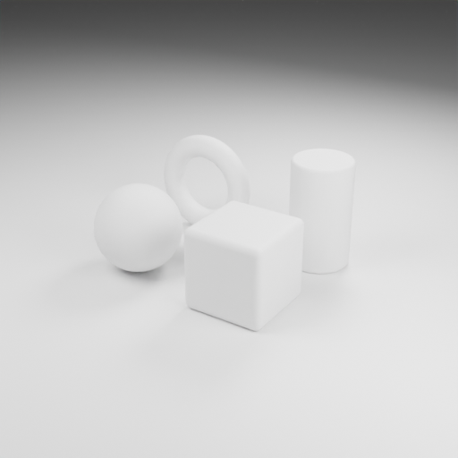
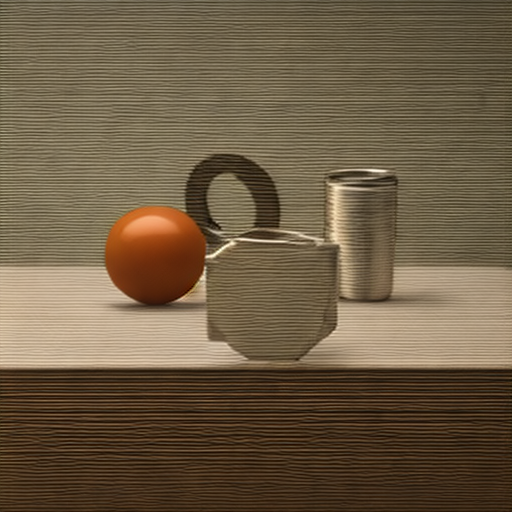

# Assignment 07 — Depth-Controlled White-Model Rendering

Blender exports clay, inverted Mist depth and mapped normals. SD-Turbo Q4_0 with an SD2.1 depth ControlNet generates images through stable-diffusion.cpp on CUDA. The repository includes runnable source and selected real outputs.

## Setup

Use Windows with Python3.12, Blender4.0.1 or a compatible Blender version, and an NVIDIA CUDA-capable GPU. Install `requirements.txt` in your own environment. Blender supplies its own bpy/NumPy. Set `BLENDER_EXE` to your installed executable or place Blender on PATH. The safe launcher restores a missing PROCESSOR_IDENTIFIER from the Windows registry in the child environment.

Download the CUDA executable and matching runtime DLLs from the [pinned stable-diffusion.cpp release](https://github.com/leejet/stable-diffusion.cpp/releases/tag/master-1017-be48649) into `vendor/sdcpp/`. Keep the executable and DLLs together.

Obtain `sd_turbo-f16.gguf` from [Green-Sky/SD-Turbo-GGUF](https://huggingface.co/Green-Sky/SD-Turbo-GGUF/tree/main), and `control_v11p_sd21_depth.safetensors` from [thibaud/controlnet-sd21](https://huggingface.co/thibaud/controlnet-sd21/tree/main). Read the models' licenses on their source pages. Put these source weights in this assignment directory and create `models/`.

```powershell
& ./vendor/sdcpp/sd-cli.exe -M convert -m ./sd_turbo-f16.gguf --type q4_0 -o ./models/sd_turbo-q4_0.gguf
& ./vendor/sdcpp/sd-cli.exe -M convert -m ./control_v11p_sd21_depth.safetensors --type f16 -o ./models/control_depth_sd21-fp16.gguf
```

The control model has cross-attention context1024, matching SD2.1/SD-Turbo. Choose the **depth** weights.

## Reproduce

Run from this assignment directory:

```powershell
python scripts/run_pipeline.py --batch
python scripts/run_pipeline.py --probe
python scripts/run_precision_diagnostics.py
python scripts/prepare_figures.py
python verify_results.py
```

`--batch` generates the scene if needed, exports each resolution once, and runs A-E. It reuses existing control-map metadata on subsequent runs. After changing the scene/export code, preserve old results and invalidate the corresponding `output/demo*_export.json` before regenerating maps. `--control-image` accepts an absolute path to an existing RGB depth map; `--blender` can override BLENDER_EXE. The CLI also exposes steps, CFG, control strength, seed and CPU helper threads.

The scene contains a sphere, torus, beveled cube, cylinder, ground, three area lights and a63mm camera. Cycles uses64samples. Depth uses visible-frustum object-vertex2%/98% distance percentiles, excluding the large ground, then linear Mist inversion. Normals use n×0.5+0.5. Control maps use Raw output; the clay view uses AgX. All formal runs share seed42, Euler/discrete, the same prompts and8CPU helper threads.

Positive prompt: `photorealistic render, studio soft lighting, PBR material, preserve original 3d geometry, sharp`.

Negative prompt: `deformed geometry, perspective changed`.

## Recorded results

| Run | Size | Steps | CFG | Control | Sampling(s) | VAE(s) | Full-pipeline equivalent(s) |
|---|---:|---:|---:|---:|---:|---:|---:|
| A | 512 | 4 | 1.2 | 0.9 | 1.19 | 0.51 | 6.99 |
| B | 768 | 4 | 1.2 | 0.9 | 2.52 | 0.92 | 11.89 |
| C | 512 | 8 | 1.2 | 0.9 | 2.13 | 0.52 | 7.90 |
| D | 512 | 4 | 1.2 | 0.5 | 1.20 | 0.51 | 6.93 |
| E | 512 | 4 | 1.0 | 0.9 | 0.71 | 0.52 | 6.42 |

Data: [results.csv](output/results.csv). Clay/depth/normal share one render. Full-pipeline equivalent equals the measured resolution-specific Blender process plus the generation process. Same-resolution runs reuse maps; summing equivalent times does not give the measured batch wall time. Recorded timings come from one Windows/CUDA machine and include short-run variability.

RunA preserves the four-object layout while reshaping the cube and opening the cylinder. RunD loses both rear objects; runB adds a small sphere. Q4_0 outputs show dense horizontal textures. The F16 diagnostic reduces those textures while retaining geometric distortion. Turning off the VAE direct-convolution path or all direct convolution did not remove the textures. These extra diagnostics are separate from A-E.

Representative originals: [clay](output/demo512_clay.png), [depth](output/demo512_depth_0001.png), [normal](output/demo512_normal_0001.png), [A](output/A_photoreal.png), [B](output/B_photoreal.png), [C](output/C_photoreal.png), [D](output/D_photoreal.png), [E](output/E_photoreal.png), [F16 diagnostic](output/probe_f16.png).




Control-off and inverted-depth probes demonstrate that conditioning affects generation. Pixel differences are a condition-effect check; geometric evaluation uses visual object-by-object comparison.

Published PNGs preserve the generated pixels and omit embedded metadata. Model weights and backend binaries are obtained from the linked upstream sources. Execution logs and full command JSON are produced locally when running the scripts.
