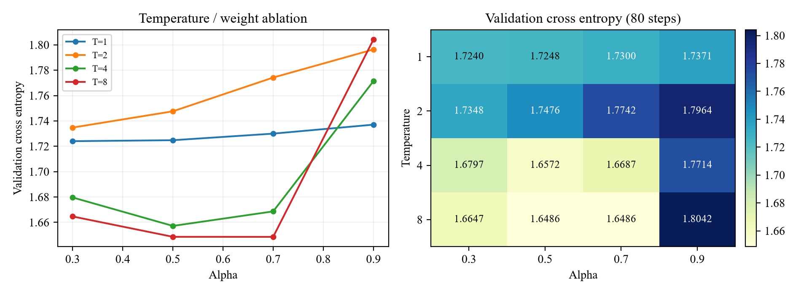

# Character-level language model knowledge distillation

Assignment 08 trains a small character GPT teacher and distills a narrower student. All text is generated locally from fixed templates plus 16 classical poems. No pretrained checkpoint, external corpus or network connection is needed during the experiment.

## Run

Python 3.12 and PyTorch 2.8 were tested. Create an environment and install the CPU dependencies:

```bash
python -m pip install torch==2.8.0 --index-url https://download.pytorch.org/whl/cpu
python -m pip install matplotlib==3.11.2 numpy==2.5.2
python -B -m unittest test_distill -v
python -B distill_lm.py --mode quick --device cpu --output outputs
python -B run_experiments.py --device cpu --output outputs
```

If a compatible CUDA-enabled PyTorch is already installed, keep that environment and use `--device cuda`. The recorded evidence used PyTorch 2.8.0+cu128, FP32 and TF32 disabled. CPU quantization always compares both precisions on the CPU. Numerical results can vary across devices and package versions.

`run_experiments.py` first executes the required teacher/student comparison, all 16 ablations and extensions A/B/D/E. It then reproduces three paired repairs and exports the final student's FP32/INT8 CPU states. Weights and run metadata are created under the chosen output directory; weights are not committed here. The default output directory is `outputs/`; choose a new directory to preserve an earlier reproduction.

For individual stages:

```bash
python -B distill_lm.py --mode teacher --retrain --device cpu --output outputs
python -B distill_lm.py --mode all --device cpu --output outputs
python -B distill_lm.py --mode ablate --device cpu --output outputs
```

## Controlled setup

| Setting | Value |
| --- | --- |
| Teacher / student width | 160 / 64 |
| Layers / attention heads / context | 2 / 4 / 96 |
| Vocabulary / train characters / validation characters | 322 / 49,457 / 5,357 |
| Teacher / baseline student steps | 200 / 120 |
| Batch / learning rate / dropout | 24 / 0.003 / 0 |
| Optimizer | AdamW, weight decay 0.01, gradient clipping 1.0 |
| Baseline KD | temperature 4, alpha 0.5 |
| Model initialization / student initialization | seed 0 / seed 7 |
| Main batch sampler | seed 1 |
| Ablation | T in {1,2,4,8}, alpha in {0.3,0.5,0.7,0.9}, 80 steps each |
| Ablation cache | 32 batches, seed 2024 |

The KD objective is `(1-alpha)*CE + alpha*T*T*KL(teacher || student)`. Logits are flattened to `(batch*sequence, vocabulary)` before `batchmean`, so the KL is averaged per token. Teacher inference is in eval mode without gradients. Each paired comparison records hashes of the initial student state and training batches.

## Recorded results

| Student comparison | Scratch loss | KD loss | Relative decrease |
| --- | ---: | ---: | ---: |
| Required: 120 steps, T=4 | 1.506015 | 1.451100 | 3.65% |
| Repair 1: 150 steps, T=4 | 1.364270 | 1.329376 | 2.56% |
| Repair 2: 150 steps, T=8 | 1.364270 | 1.320615 | 3.20% |
| Repair 3: 180 steps, T=8 | 1.289050 | 1.252956 | 2.80% |

Both students always use the same step budget within a row. Alpha remains 0.5 throughout the repairs. The original 120-step comparison is retained. The final 13.65% loss reduction relative to the initial KD run combines the longer training budget with the temperature change; it is not a same-budget KD gain.

- **Parameters:** teacher 737,280; student 147,456; exact 5× reduction.
- **Feature KD (A):** adding a 0.1-weight hidden-state MSE gives loss 1.428776 at 120 steps. The 64→160 projection adds 10,400 training-only parameters and is not part of the exported student.
- **Heatmap (B):** the best 80-step cell is T=8, alpha=0.7, loss 1.648586. T=8, alpha=0.5 is almost tied at 1.648623. T=8, alpha=0.9 is worse at 1.804192.
- **Teacher scan (E):** widths 96/160/256 give teacher losses 1.126335/0.998556/0.934760 and KD student losses 1.456957/1.451100/1.455087. A stronger teacher does not monotonically improve this fixed-budget student.
- **Dynamic INT8 (D):** the final student's state file decreases from 674,643 to 324,607 bytes. CPU validation loss changes from 1.252956 to 1.253598. The measured forward latency was 3.8966 ms for FP32 and 4.2687 ms for INT8, so storage improved without a latency improvement in this measurement.

Quantization timing uses 8 CPU threads, batch 24, context 96, 10 warmup forwards and five groups of 30 measured forwards. The reported latency is the median of the five group means. Only Linear layers are quantized; embeddings, LayerNorm and causal masks remain. Raw timing groups are retained in the result JSON.

The fixed generation prompt is `月`, followed by 60 sampled characters at temperature 0.9, top-k 20 and seed 20261106. Exact outputs are included in the JSON. Training and validation use different grammar-generation seeds but share the 16 appended poems; these results mainly measure learning within the synthetic grammar.

## Evidence and checks

- [Result records](results/results.json): baseline, all ablations, feature KD, teacher scan, three repairs, generation samples and final quantization.
- [Summary CSV](results/results_summary.csv) and [configuration](results/config.json).
- [Per-step histories](results/histories/): CE, scaled KL, feature MSE, total loss and gradient norm. Repair histories are grouped by round.
- [Training curves](figures/training_curves.png), [ablation plot and heatmap](figures/ablation_heatmap.png), [repair and teacher scan](figures/repair_and_teacher_scan.png).
- `test_distill.py`: exact parameter count, causal masking, KL direction/gradient/token averaging, evaluation-state restoration and identical initialization.
- `run_experiments.py`: paired-run integrity checks, unchanged teacher, all 16 ablations, final checkpoint reload and exact FP32/INT8 serialization round trips.



The code package contains source and selected reproducibility evidence. The course report, instructions, template, slides, model weights and machine-specific logs are kept outside this attachment.
