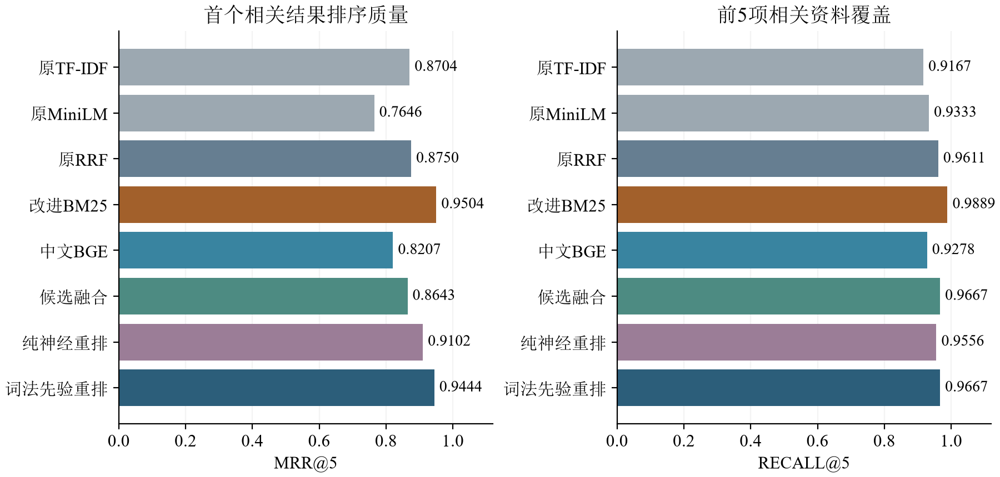

# 中文课程知识检索优化与神经重排比较

这是期末项目优化版。30条固定知识卡片，原60题在结果可见后作为开发诊断数据，新增90题在配置选择前冻结、锁定方案后首次评测。旧代码与results/保留，不混算新旧测试分数。

## 当前结果

新90题经CODEX全量相关性核对后记录7处更正：只修改评分标签，不改问题、资料、参数或900条模型排名。原始评分与更正评分都保留，新题尚无独立人工逐项审核。3道学生确认仅属于旧题。

|方法|Recall@1|Recall@3|Recall@5|MRR@5|时延ms|
|---|---:|---:|---:|---:|---:|
|原TF-IDF|0.7722|0.9000|0.9167|0.8704|0.038|
|原MiniLM|0.6056|0.8833|0.9333|0.7646|14.070|
|原RRF|0.7667|0.9278|0.9611|0.8750|15.124|
|改进BM25|0.8611|0.9778|0.9889|0.9504|0.212|
|中文BGE|0.6944|0.8889|0.9278|0.8207|6.362|
|候选融合|0.7444|0.9278|0.9667|0.8643|6.352|
|纯神经重排|0.8111|0.9444|0.9556|0.9102|43.590|
|词法先验重排|0.8556|0.9667|0.9667|0.9444|43.188|

时延来自事先指定15题（前5概念×3种题型），每题每方法3次，GPU同步；不含加载/索引。词法在CPU、神经方法在CUDA FP32，不能把硬件差异解释为算法加速倍数。

推荐BM25：当前小型术语语料中质量和代价更好。神经方案开发集MRR为0.9181，但新测试未超过强词法基线。没有按测试结果继续调参，也不宣称公共基准领先。



## 安装与模型

Python 3.12。已有环境可直接用；新电脑可创建环境后安装requirements.txt。CUDA不是纯词法查询必需条件。

```powershell
python -m venv .venv
.\.venv\Scripts\python.exe -m pip install -r requirements.txt
python -B query.py '什么是过拟合？' --method bm25
python -B demo/app.py --lexical-only
```

纯词法模式只加载NumPy/CPU索引，不加载任何神经权重。浏览器访问 http://127.0.0.1:8765/ ，Ctrl+C结束；直接双击HTML不能运行接口。

如需完整神经对比，明确下载官方固定版本模型：

```powershell
python prepare_model.py
$env:COURSE_MODEL_PATH = (Resolve-Path '.\models\minilm').Path
python download_optimization_models.py
python -B demo/app.py
```

原MiniLM约0.47GB；新增BGE-small-zh约96MB、reranker-base约1.11GB，模型不随仓库发布。下载脚本固定revision，来源为官方Hugging Face，全部缓存和模型留在项目下。两个BGE模型MIT许可，MiniLM为Apache-2.0。没有GPU时完整演示可加 --device cpu，时延会不同。

## 一条命令复跑评分

```powershell
python -B -m unittest discover -s tests -v
python -B optimize.py test --out results_v2/reproduce
python -B experiments/audit_qrels.py --results results_v2/reproduce
```

使用已发布的锁定配置，不重新调参；已有结果目录拒绝覆盖。无GPU可在optimize.py中显式加 --device cpu，报告会标记设备改变。原始指标在new_test_summary.json，更正指标在audited_summary.json。界面读取正式results_v2/audited_summary.json，不会悄悄用任意复跑目录替换正式统计。

开发阶段的optimize.py dev和select_final_config.py仅用于重现历史工作顺序；已有锁定文件时拒绝覆盖。不要为了优化已公开的新测试集而删除锁定文件重新选择参数。

## 方法与证据

- advanced_retrieval.py：中文单字/双字/完整英文词BM25，中文BGE CLS编码，有限正证据RRF，候选交叉编码与词法先验分数融合；不读取题目标签。
- data/v2：原始90题冻结清单、7处更正和全部更正理由。问题与资料正文均保持原样。
- results_v2：120组纯重排、180组分数融合开发比较、固定配置、900条首次与更正排名评分、450条原始计时和题型表。
- 移除词法先验、移除神经分数在同一候选集内比较；仅BGE候选是另一个候选来源对照。
- .gitattributes关闭自动换行转换，避免改变冻结文件字节hash。

900条新测试排名与更正指标已在干净输出目录复跑一致，CPU独立BM25入口亦与90题正式排序一致；10项单元测试与8项CPU-only接口检查通过。`results_v2/release_verification.json`记录发布源文件hash及复现检查。锁定文件中的code_hashes对应评测时的历史代码；之后只增加独立输出、CPU部署、网页和下载完整性检查，不改排序公式、锁定参数或问题。model_records中的bytes是下载目录总量，实际权重字节与校验另列在发布检查中。小样本、AI共同构造数据和后验标注核对仍限制结论，完整原始结果保留以便检查。

## 技术来源

[BM25](https://doi.org/10.1561/1500000019)、[Sentence-BERT](https://arxiv.org/abs/1908.10084)、[BGE / C-Pack](https://arxiv.org/abs/2309.07597)、[BGE-small-zh](https://huggingface.co/BAAI/bge-small-zh-v1.5)、[重排器](https://huggingface.co/BAAI/bge-reranker-base)、[RRF](https://plg.uwaterloo.ca/~gvcormac/cormacksigir09-rrf.pdf)。

只做原文检索，不生成回答或检测资料外问题。归一化分数不是正确概率。中文报告和LaTeX源文件在本地审阅，不属于公开代码附件。
