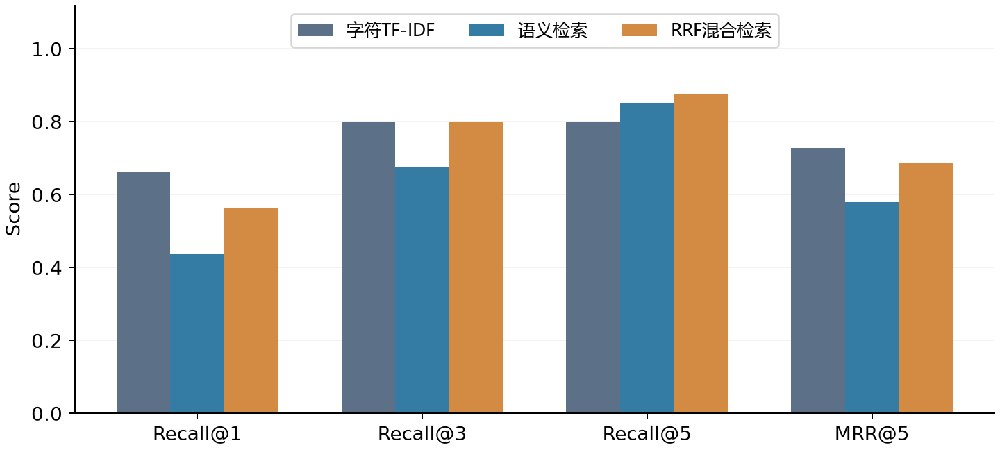

# 中文课程知识检索对比

输入课程问题，比较字符TF-IDF、MiniLM语义检索和RRF排名融合，返回原文及来源。项目只检索，不生成回答，也不检测资料外问题。

## 结果与边界

30条自编知识卡片，60道问题，20开发/40测试；配置在测试前固定。测试集结果：

|方法|Recall@1|Recall@3|Recall@5|MRR@5|
|---|---:|---:|---:|---:|
|字符TF-IDF|0.6625|0.8000|0.8000|0.7292|
|MiniLM语义检索|0.4375|0.6750|0.8500|0.5804|
|RRF混合检索|0.5625|0.8000|0.8750|0.6858|

混合检索提高前5项召回，但首位排序和MRR不及关键词方法。没有训练或微调模型，RRF是已有方法。消融是移除一个分支，与单分支的排序等价。

问题和卡片由CODEX共同整理，非独立公共基准；学生已确认3道代表题对应关系，其余57题未逐项人工核验。问题类型与开发/测试分布不平衡，不能将两者差异完全归因于泛化。详情见[data](data/)和[逐题结果](results/per_question.json)。



## 安装和首次准备

Python 3.12，在本目录运行。新电脑建议创建独立环境；本项目CPU推理，无需CUDA。依赖来自真实运行环境，完整包快照另见requirements-installed.txt。

```powershell
python -m venv .venv
.\.venv\Scripts\python.exe -m pip install -r requirements.txt
.\.venv\Scripts\python.exe prepare_model.py
$env:COURSE_MODEL_PATH = (Resolve-Path '.\models\minilm').Path
```

prepare_model.py仅用于明确需要下载的新电脑。已有同版本模型时直接设置COURSE_MODEL_PATH，检索与评测使用local_files_only离线加载。模型为Apache-2.0许可，权重不随仓库发布，来源与固定revision见[config.json](config.json)。

## 查询与复现

```powershell
python -B query.py '为什么新题表现不好？' --method hybrid --k 5
python -B -m unittest discover -s tests -v
python -B run_experiments.py --out results/reproduce
python -B demo/app.py
```

浏览器访问`http://127.0.0.1:8765/`。不要直接双击HTML，否则无法调用Python模型。Ctrl+C停止服务。可用`--model-path`传模型目录，演示可用`--port`改端口。

实验拒绝覆盖已有逐题结果，请换新的--out目录。演示默认展示results/中的正式汇总，新复跑目录不自动替换正式结果。build_data.py只记录数据的构建过程，已有freeze.json时拒绝重写，不应在每次评测前重新造题。数据hash基于原始字节，.gitattributes关闭自动换行转换，避免不同系统检出时改变冻结文件。

指标与排序在同一环境重跑应一致；查询计时随系统负载波动。每题每方法预热后运行3次，保存全部540条计时，查询含编码、匹配、排名及结果封装，不含模型加载和建索引。均值池化考虑attention mask，归一化后使用内积；不是CLS向量。

## 文件

- retrieval.py：原文输入、词法与语义表示、排名融合；不读取问题标注。
- run_experiments.py：验证数据hash、运行基线与消融、导出表图与环境证据。
- data/：知识卡片、问题、来源、冻结清单、3题抽查记录及来源链接勘误。
- demo/：仅监听本机的HTTP服务与网页。
- results/：逐题结果、汇总、原始计时、图表及真实页面截图。

当前实现为小规模全量比较，词法矩阵使用NumPy稠密存储；扩大到大规模资料需要倒排索引与向量索引。未实现检索分数校准，相似度与RRF分数不能解释为正确概率。

## 技术来源

- [模型与mean pooling示例](https://huggingface.co/sentence-transformers/paraphrase-multilingual-MiniLM-L12-v2)
- [Sentence-BERT](https://arxiv.org/abs/1908.10084)
- [RRF原始论文](https://plg.uwaterloo.ca/~gvcormac/cormacksigir09-rrf.pdf)
- [TF-IDF定义](https://scikit-learn.org/stable/modules/feature_extraction.html#tfidf-term-weighting)

代码为本项目实现，不依赖旧作业目录或Sentence Transformers安装。课程报告、教师课件、原模板、模型权重、私人环境路径不属于公开附件。
